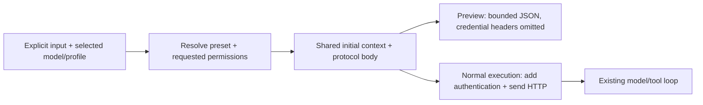

# Preview the first model request / 首轮模型请求预览（main，尚未发布）

After preparing input, inspect what zi would send before making a model request:

```sh
zi --preview --no-stream -i sanitized.jsonl -s builtin:triage
zi --preview --no-stream -i sanitized.jsonl -s builtin:triage -o request.json
zi --preview --exact --export-plan -i data.json "选择 items 数组再按次数排序"
```

`--preview` emits a version-1 JSON inspection envelope containing `request.method`,
`request.url`, and the **actual initial request body** under `request.body`. It also
reports whether authentication is configured, whether project tools are enabled, and
the logical-turn budget. It does not create an HTTP client, resolve DNS, contact a
provider, run tools or prompt for configuration. A model name is required; a key is
not required for inspection. Normal execution retains its existing key requirements.

The JSON body includes the resolved instruction/preset, explicit input, system rules
and currently available tool definitions. It is not a data-sanitization operation.
Configured authentication headers and their key values are omitted; their presence is
reported as a boolean. Original task input or explicit instructions may themselves
contain secrets, so review and handle the preview as task content. Endpoint validation
continues to reject URL credentials, query strings and fragments.

## Same construction, separate execution

Preview and real requests share initial context preparation and protocol-body construction:



Chat Completions uses `messages`; Responses uses `input` with `store=false`;
Anthropic uses `system`, `messages` and the selected `max_tokens`. Saved exact-endpoint
rules and CLI/environment/profile precedence remain the same. Preset variables resolve
literally through the existing preset flow, and JSON presets add the same answer-format
instruction as a real task.

`--json` describes the requested model answer, while the preview itself is always a
JSON inspection envelope. `--exact --export-plan --preview` previews the request to
propose a native plan; it does not export TOML or execute a transform. No second model
turn or tool result can be previewed in advance. This is neither an authentication
probe nor proof that a provider/model will accept the request or complete the task.

Streaming is computed from the same flags and output destination as a normal run.
A terminal can select `stream=true` automatically; redirecting or saving to a file
normally selects false. Use `--no-stream` when comparing a saved/pipe preview with
a later terminal run. `--stream` explicitly selects true; normal conflicts still apply.

## Explicit project context

```sh
zi --preview --read-only -C ./project "解释这个项目的输入输出"
zi --preview --no-exec -C ./project "检查并修复字段处理"
```

Project options inspect the same selected root and root `AGENTS.md` used for the first
request. They do not scan or automatically attach other project files. Read-only mode
omits file-write/command tools; no-exec mode omits commands; `--no-tools` omits tools
and project context. No tool call is executed, no plan/read/undo state is persisted,
and no process-interrupt handler is installed for preview. Nested instructions and later file
contents may enter future requests during actual execution and are outside this preview.

## Output and failure behavior

The preview is UTF-8 JSON on stdout, including in a terminal, with no rich result card
or activity display. Terminal display uses JSON Unicode escapes for literal DEL/C1
controls, preserving parsed values and legal formatting whitespace; pipe/file bytes
and the actual request body retain their original values. The 16 MiB cap also applies
after terminal escaping. The escaped byte length is checked before allocating the
terminal display buffer; oversized previews fail without printing a JSON prefix.
`-o FILE` uses normal complete-result publication: no overwrite by
default, `--force` replaces only after successful preparation/serialization, and failure
preserves an existing result. Input limits still apply; encoded preview output is capped
at 16 MiB while serializing (control characters can expand). No partial JSON is emitted.

Provide an instruction or a preset. Preview never opens an interactive task session.
Offline/management commands, `--count`, `--select` and `--config-example` reject this
model-task mode before input/output processing. Bad config, invalid project context,
invalid UTF-8, incompatible task modes and exceeded bounds return a nonzero exit.

需要先遮盖敏感值时，先离线执行 `zi data --recipe share.toml` 并审阅结果，再把结果
传给 `--preview` 或模型任务。预览不会自动遮盖，也不会发送请求；去掉 `--preview`
之后是一次新的正常执行，不是对已预览请求的锁定重放。文件、配置或终端环境的改变会影响
随后构造的请求。当前正式 v0.31.0 安装包尚不包含本功能，等待下一批统一发布。
